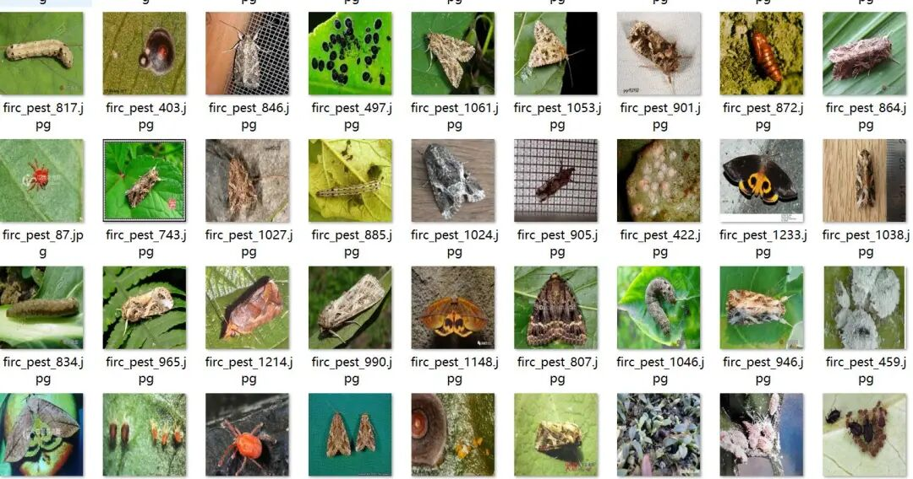
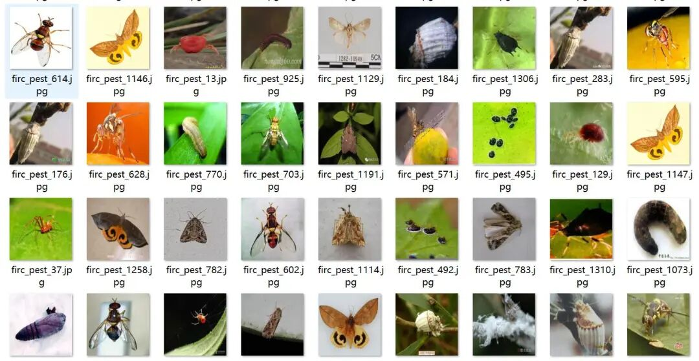
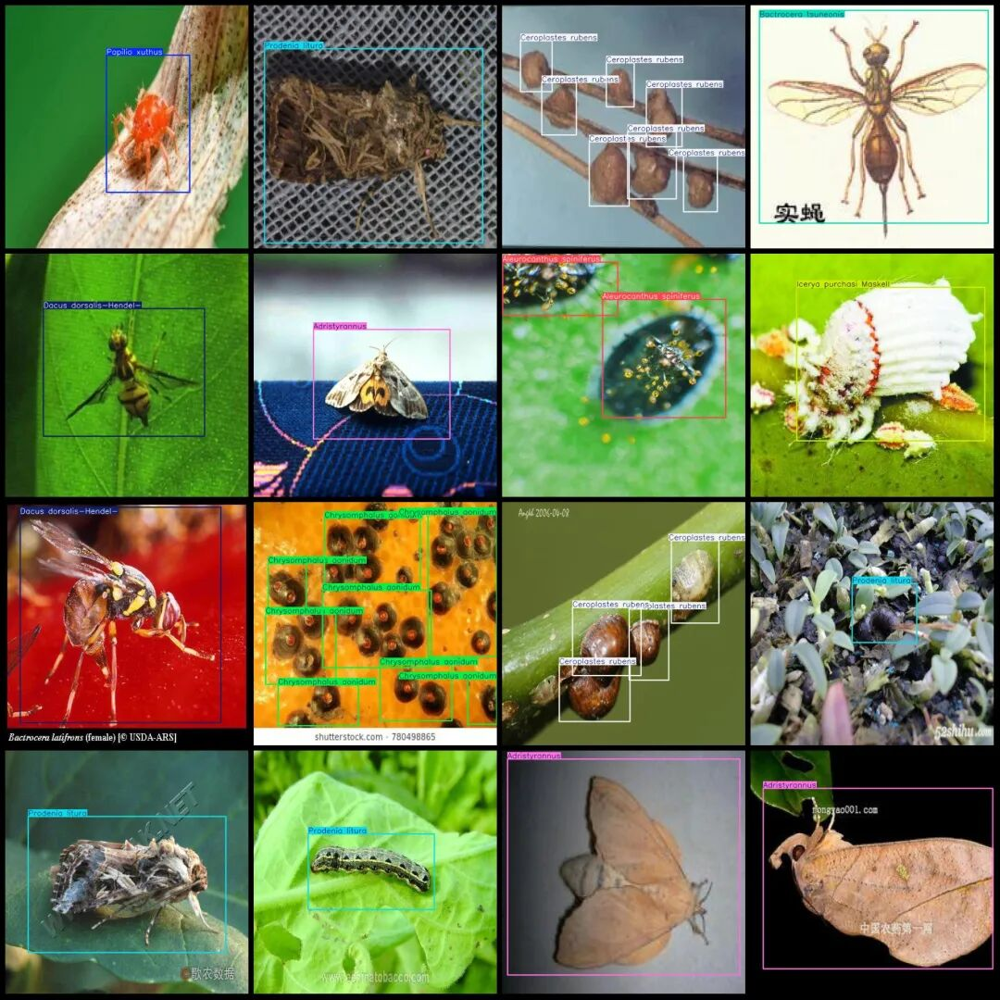
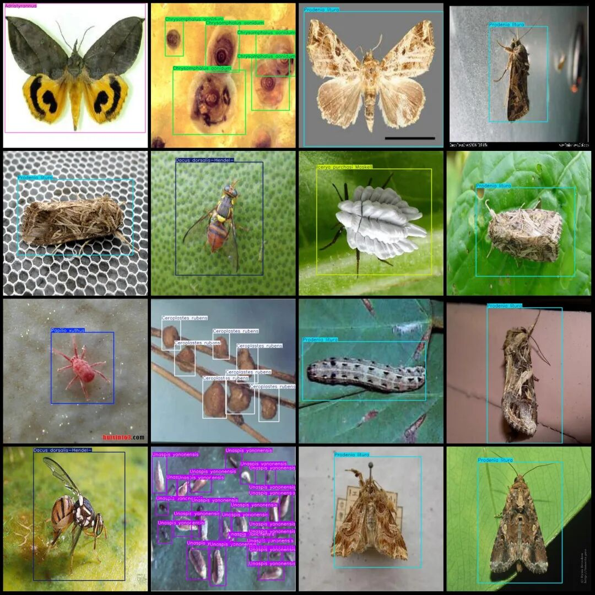

# Intelligent Agriculture Citrus Pest Detection Dataset VOC+YOLO format with 1335 images in 17 categories

Dataset format: Pascal VOC format + YOLO format (txt file without split path, only containing jpg images and corresponding VOC format xml files and yolo format txt files)

Number of images (number of jpg files): 1335

Number of annotations (number of xml files): 1335

Number of annotations (number of txt files): 1335

Labeling category count: 17

Annotation category names (Note that the order of categories in the YOLO format does not correspond to this, but is based on the labels folder's classes.txt): ["Adristyrannus", "Aleurocanthus spiniferus", "Aphis citricola Vander Goot", "Bactrocera tsuneonis", "Ceroplastes rubens", "Chrysomphalus aonidum", "Dacus dorsalis-Hendel-", "Icerya purchasi Maskell", "Nipaecoccus vastalor", "Panonchus citri McGregor", "Papilio xuthus", "Phyllocnistis citrella Stainton", "Prodenia litura", "Tetradacus c Bactrocera minax", "Toxoptera aurantii", "Toxoptera citricidus", "Unaspis yanonensis"]

Number of boxes labeled in each category:

Adristyrannus (Aderiskanthus) = 133

Aleurocanthus spiniferus (spiny whitefly) frame count = 148

Aphis citricola Vander Goot (Ramulus) = 8

Bactrocera tsuneonis (Japanese sweet orange fruit fly) frame count = 27

Ceroplastes rubens (Red wax scale) frame count = 370

Chrysomphalus aonidum (brown cynipid) frame count = 183

Dacus dorsalis-Hendel-(Cherry Tip Moth) frame count = 131

Icerya purchasi Maskell (Purchase's Icerya) frame count = 290

Nipaecoccus vastalor (Boxelder's scale) frame count = 46

Panonchus citri McGregor (citrus full-fingered mite) frame count = 82

Papilio xuthus (citrus swallowtail) frame count = 108

Phyllocnistis citrella Stainton (citrus leaf miner) = 23

Prodenia litura (striped night moth) frame count = 438

Tetradacus c Bactrocera minax (citrus big fruit fly) frame count = 58

Toxoptera aurantii (tea aphid) frame count = 28

Toxoptera citricidus (citrus aphid) frame count = 22

Unaspis yanonensis (Yan Ying Xi) frame count = 546

Total frame count: 2641

Image resolution: 640x640

Using labelImg:

Annotation rules: Draw a rectangle around the category.

Important Notice: The dataset does not have separate training, validation, and test sets; you need to partition them yourself.

Special : This dataset does not guarantee the accuracy of the trained models or weight files.

Image Preview:

Annotation example:

## Payment

Here is a pay link on Stripe ( https://buy.stripe.com/3cs8yP7sY87d0vu9AB ). Please contact me lonlonago@foxmail.com after funding $89, and I will send you a complete data files , thank you!

